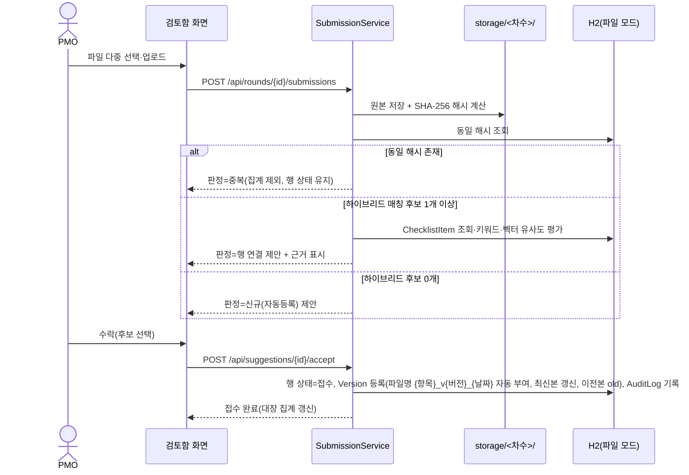

# 산출물 접수·검토 보드 업무설계서

질문: 산출물 접수·검토 보드의 업로드 접수 요청은 어떤 순서로 처리되나? 답: 업로드 → 원본 저장(`storage/<차수>/`) → 해시·중복 판정 → 하이브리드 매칭(키워드+벡터 유사도) → 제안 카드 → PMO 수락 → 행 상태 갱신 + 버전 등록 + 감사 로그 순서로 처리한다.

## 1. 개요

- 대상 요구·인수 기준: REQ-outputhub-003~010, AC-004-1, AC-004-2, AC-005-1, AC-006-1, AC-007-1, AC-008-1, AC-009-1
- 화면: SCR-outputhub-01, SCR-outputhub-02, SCR-outputhub-03
- 선행 조건·권한: PMO 단일 역할(D-001, 로그인 없음). 차수와 기준대장이 등록되어 있어야 함.

## 2. 처리 흐름

| 단계 | 처리 | 담당(화면·서비스·DBIO·연계) | 가리키는 ID | 근거(경로·심볼) |
|---|---|---|---|---|
| 1 | 파일 수신·원본 저장 | 서비스(StoragePort) | L-outputhub-001 | 구현 시 backend storage 패키지 |
| 2 | 해시·중복 판정 | 서비스(MatchService) | L-outputhub-002 | 구현 시 backend match 패키지 |
| 3 | 하이브리드 매칭(키워드·벡터 유사도) | 서비스(MatchService) | L-outputhub-003 | 규칙·가중치 소스: 설정 파일(REQ-outputhub-014) |
| 4 | 벡터 유사도 보정 | 서비스(MatchService) | L-outputhub-004 | 파일명 2-gram TF-IDF 코사인을 키워드 점수에 합산(REQ-outputhub-004) |
| 5 | 제안 카드 생성·표시 | 화면(Vue) | SCR-outputhub-02 | — |
| 6 | 수락 → 상태·버전·감사 처리 | 서비스(DeliverableService) | L-outputhub-005 | — |

## 3. 업무 규칙

| 규칙 | 조건 | 결과 값·판단 | 로직 ID |
|---|---|---|---|
| 관리 단위 | 집계·상태 기준 | 대장 행(산출물 항목) 단위. 파일 수 아님(파일 5개 접수 = 행 기준 4종 접수일 수 있음) | L-outputhub-005 |
| 상태 전환 | 현재 상태별 허용 전환 | 미제출→접수, 접수→확정, 접수→보완 필요, 보완 필요→접수(재접수), 확정→접수(교체 승인 시만). 그 외 전환은 거부 | L-outputhub-006 |
| 중복 무효 | 파일 해시 동일 | 접수 집계에 포함하지 않고 행 상태 유지 | L-outputhub-002 |
| 확정본 보호 | 행 상태 = 확정 | 새 업로드는 후보로만 쌓임. 교체 승인 전까지 최신본 불변 | L-outputhub-007 |
| 신규 자동등록 | 키워드·벡터 후보 모두 0 | 신규(자동등록) 행 추가, 필수=아니오, PMO 승인 전까지 집계 제외 | L-outputhub-004 |
| 매칭 우선순위 | 후보 여러 개 | 하이브리드 점수 상위순 나란히 제안, 동률이면 선택 보류(AC-004-2) | L-outputhub-003 |

## 4. 데이터

| 테이블(T)·쿼리(Q) | 읽기·쓰기 | 컬럼·조건 | 트랜잭션 경계 |
|---|---|---|---|
| Round | 읽기·쓰기 | id·차수명·단계·수행사 | 차수 생성 1건 |
| ChecklistItem(대장 행) | 읽기·쓰기 | 산출물명·단계·수행사·필수 여부·상태 | 상태 전환 단위 트랜잭션 |
| Submission | 쓰기 | 파일명·원본 경로·SHA-256·업로드 일시 | 업로드 1건당 |
| MatchSuggestion | 쓰기 | 대상 행·판정 종류·근거(키워드·위치)·상태(대기/수락/거절) | 판정 1건당 |
| Deliverable | 읽기·쓰기 | 행↔파일 버전 묶음, 최신본 포인터 | 수락 시 Version과 함께 |
| Version | 읽기·쓰기 | 버전 번호·파일 참조·old 여부 | 수락 트랜잭션에 포함 |
| AuditLog | 쓰기 | 행동 종류·대상·일시·주체(PMO) | 상태 변경 트랜잭션에 포함 |

- 저장소: 원본 파일은 H2 밖 로컬 폴더 `storage/<차수>/`에 두고 DB는 경로만 보관(NFR-outputhub-002). old 버전은 `storage/<차수>/old/`로 이동.

## 5. 연계

| 인터페이스(API·IF) | 상대 | 주고받는 것 | 타임아웃·재시도 |
|---|---|---|---|
| REST API(앞의 표) | Vue 프론트 | JSON·multipart | 로컬 실행(D-003), 재시도는 화면 다시 시도 버튼 |

## 6. 오류·예외·복구

| 상황 | 처리 | 메시지(MSG)·오류코드 | 재시도·취소·중복 요청 |
|---|---|---|---|
| 권한 없음 | 해당 없음(단일 역할) | — | — |
| 파일 저장 실패 | 업로드 거부, 원본 미반영 | "파일 저장에 실패했습니다. 다시 시도하세요" | 파일 단위 재시도 |
| 동일 해시 재업로드 | 검토 대기 제안이 있으면 그 제안을 다시 표시(새 접수·제안 생성 없음), 없으면 중복 표시·무효 처리 | 대기 제안 재표시 또는 "이미 접수된 파일입니다(중복)" | 재업로드 무제한 허용(무효만 표시) |
| 검토함 이탈 후 재입장 | 대기 중 제안 목록 재조회(GET /api/projects/{id}/suggestions) | — | 수락 후에도 화면 이동 없이 나머지 제안 이어서 처리 |
| 상태 전환 위반(예: 확정 재확정) | 409 반환, 상태 재조회 | "이미 확정된 산출물입니다" | 화면 상태 재조회 |
| 확정 상태에서 새 파일 | 후보로만 쌓음 | "확정본이 있습니다. 교체 승인 후 반영됩니다" | 후보 대기 |
| 매칭 후보 2개 동률 | 선택 보류 | "후보를 선택하세요" | PMO 선택 전까지 행 미변경 |

## 7. 영향 범위

- 신규 구현: backend(Java 17/Spring Boot 3.x/JPA, 패키지 구성 STD-001 §7), frontend(Vue 3 + TS, 화면 3개), H2 파일 DB, `storage/` 로컬 저장소, 설정 파일(매칭 규칙·기본 산출물 목록·허용 확장자).
- 시험: TS-outputhub-P01 TC-01~09가 위 규칙·흐름을 직접 검증. JUnit 5 Given-When-Then(NFR-outputhub-003).

## 8. 남은 것

- [확인 필요: 매칭 규칙 설정 파일 스키마(키워드·확장자·점수 가중치) 구체 값 · 확인자: 개발 담당 · 기한: 미정]
